<div align="center">

> **A note before you start**
>
> Listeny was built by a Muslim developer, for purposes other than songs. Songs and musical instruments (*al-ma'azif*) are haram in Islam, so this app was made for listening to the Qur'an, podcasts, poetry, lectures, and any other audio that isn't songs. Please respect that.
>
> **ملاحظة قبل أن تبدأ:** برمج هذا التطبيق مسلم، لأغراض غير الأغاني. فالأغاني والمعازف حرام في الإسلام، وإنما صُنع التطبيق للاستماع إلى القرآن والبودكاست والشعر والمحاضرات وكل ما سوى ذلك. نرجو من الجميع احترام ذلك.

<br/>

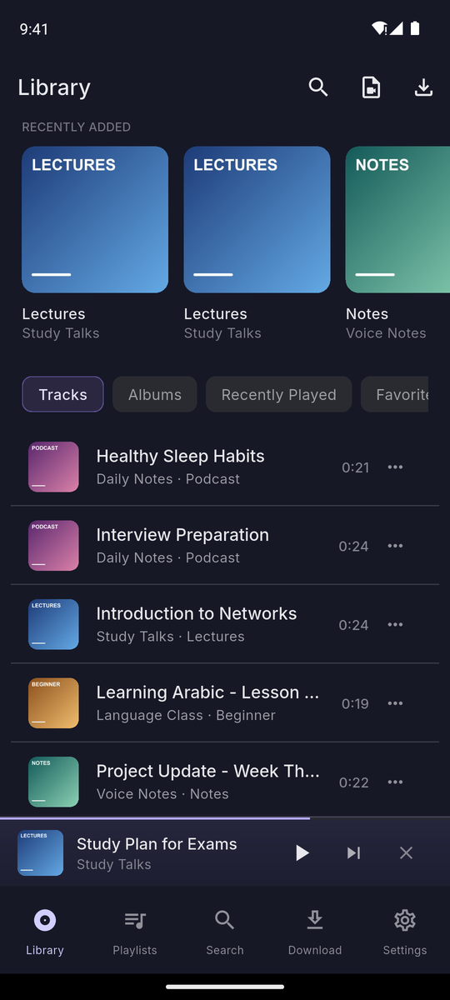

# Listeny Lite

**Your audio, on your phone, without the cloud.**

A private audio player for Android. No account, no ads, no tracking, and it works without internet.

<br/>

[**⬇ Download for Android**](https://github.com/mukaddam-ali/Listeny-App/releases/latest)

Version 1.3.1 &nbsp;·&nbsp; Android 7.0 or newer &nbsp;·&nbsp; about 150 MB

</div>

---

## Why Listeny

Most players want you to sign in, sync to a server or stream everything. Listeny does the opposite. You bring the recordings you already have, it keeps them on your phone, and from then on everything works offline: browsing, searching, playlists, background playback and the lock-screen controls.

- **Private by design.** Nothing is uploaded. The library is a database that lives on your phone.
- **Built for listening.** Skip back and forward 10 seconds, remember where you stopped, keep playing with the screen off.
- **Tidy.** Tracks, albums, playlists and favourites, with fast search.
- **Yours to edit.** Rename tracks, trim them, or pull the audio out of a video.

## Download and install

**Android**

1. On your phone, open the [latest release](https://github.com/mukaddam-ali/Listeny-App/releases/latest) and download **Listeny-Lite-1.3.1.apk**.
2. Open the file. If Android asks, allow your browser or file manager to install apps from this source.
3. Tap **Install**, then open Listeny.

One APK works on every Android phone (Samsung, Motorola, Xiaomi, Vivo, Oppo, Pixel and the rest).

Because the app isn't on the Play Store, Google Play Protect may show a warning the first time. That's normal for any app installed outside the store.

SHA-256 of the APK, if you'd like to check your download:

```
a6adb38db13b63f971356f383f8909a5ef8ee7ab49a5bb77d76ef53bc7f31885
```

**iPhone**

There is no iPhone download yet. The iOS version builds, but it hasn't been tested on a real iPhone, so I'm not offering it until it has. The tour below shows how every screen works, so you can see what the app does.

---

## A tour of the app

### Your library

<table>
<tr>
<td width="33%" valign="top" align="center">
<br/>
<b>Library</b><br/>
Everything you've added, with the newest at the top. Switch between Tracks, Albums, Recently Played and Favourites.
</td>
<td width="33%" valign="top" align="center">
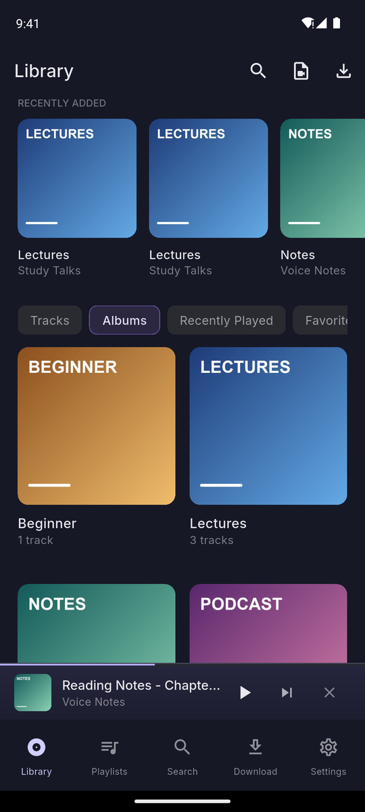<br/>
<b>Albums</b><br/>
Your tracks grouped by album, using the cover art stored in each file.
</td>
<td width="33%" valign="top" align="center">
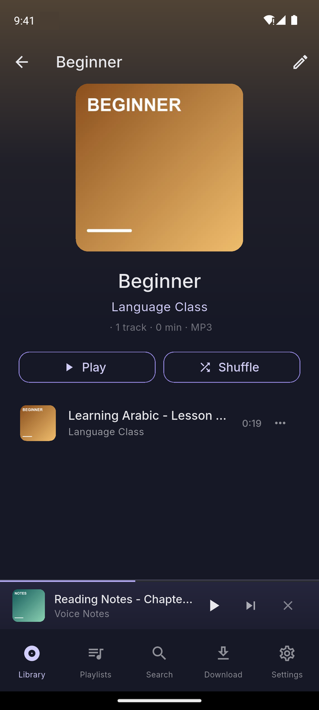<br/>
<b>Album page</b><br/>
Play or shuffle a whole album, or edit its details with the pencil.
</td>
</tr>
</table>

### Listening

<table>
<tr>
<td width="33%" valign="top" align="center">
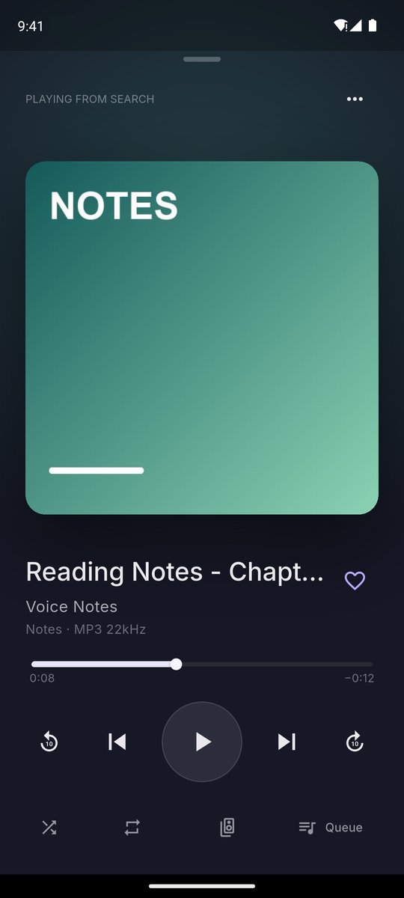<br/>
<b>Now playing</b><br/>
Big cover, a seek bar, previous and next, plus 10-second back and forward buttons. Shuffle, repeat and the queue are one tap away.
</td>
<td width="33%" valign="top" align="center">
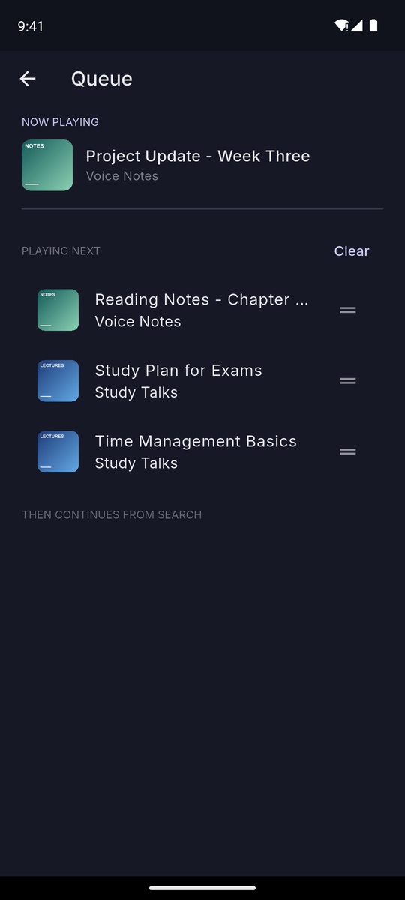<br/>
<b>Queue</b><br/>
See what's coming next. Drag to reorder, or clear everything that's still waiting.
</td>
<td width="33%" valign="top" align="center">
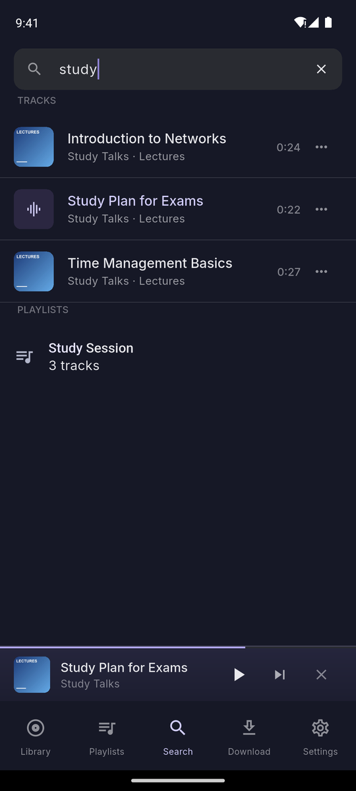<br/>
<b>Search</b><br/>
Type a few letters and get matching tracks, albums, artists and playlists straight away.
</td>
</tr>
</table>

### Playlists and organising

<table>
<tr>
<td width="33%" valign="top" align="center">
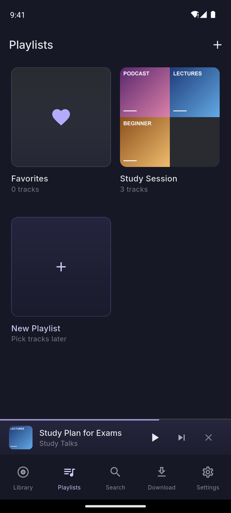<br/>
<b>Playlists</b><br/>
Create playlists and keep a Favourites list. Each playlist gets a cover made from its tracks.
</td>
<td width="33%" valign="top" align="center">
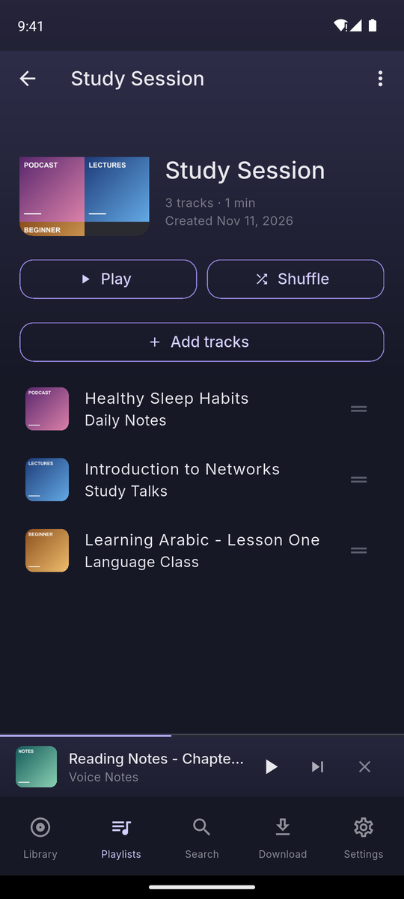<br/>
<b>Inside a playlist</b><br/>
Play, shuffle, add tracks, and drag the handles to put them in the order you like.
</td>
<td width="33%" valign="top" align="center">
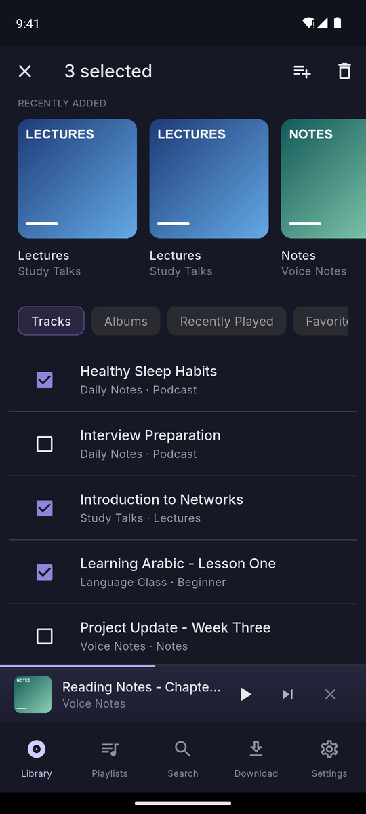<br/>
<b>Select several</b><br/>
Long-press a track to select more, then add them all to a playlist or delete them together.
</td>
</tr>
</table>

### Tools

<table>
<tr>
<td width="33%" valign="top" align="center">
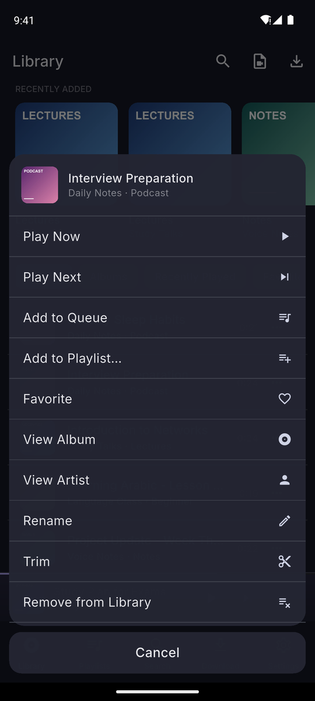<br/>
<b>Track menu</b><br/>
Tap the three dots on any track: play now, play next, add to queue or a playlist, favourite, rename, trim or remove.
</td>
<td width="33%" valign="top" align="center">
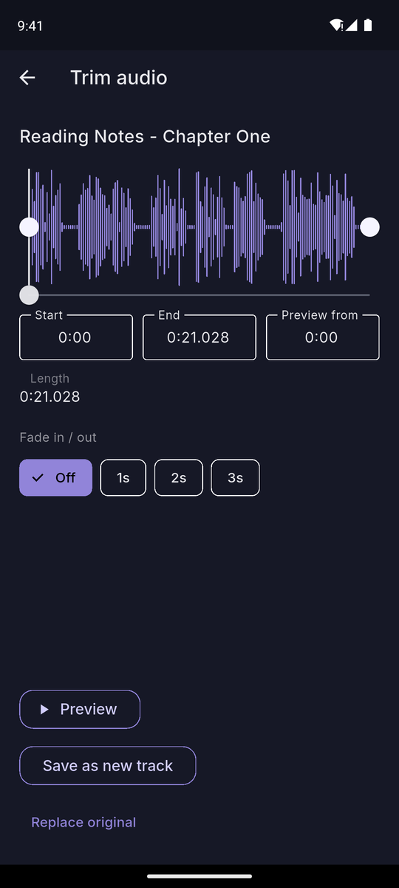<br/>
<b>Trim</b><br/>
Cut a recording down to the part you want. Drag the handles or type exact start and end times, preview it, add a fade, then save a new track or replace the original.
</td>
<td width="33%" valign="top" align="center">
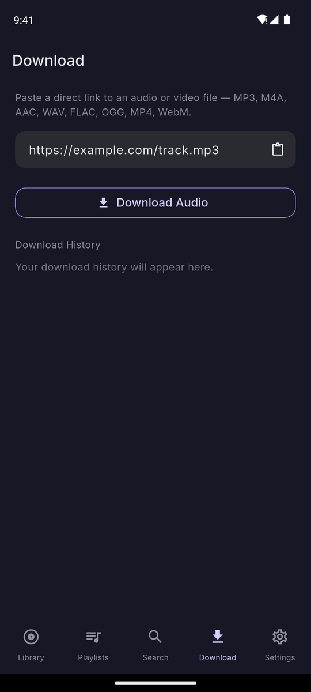<br/>
<b>Download from a link</b><br/>
Paste a direct link to an audio or video file and Listeny saves it as an MP3.
</td>
</tr>
</table>

### Settings and themes

<table>
<tr>
<td width="33%" valign="top" align="center">
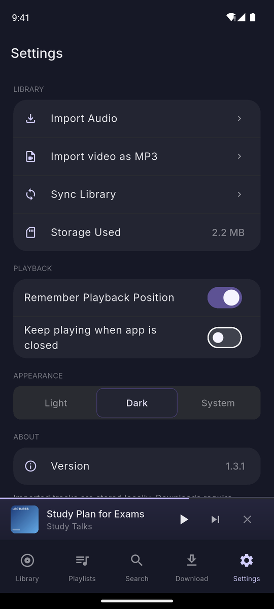<br/>
<b>Settings</b><br/>
Import audio, extract audio from a video, sync what's already on your phone, and see how much space Listeny uses. Choose whether it remembers your position and whether it keeps playing after you close the app.
</td>
<td width="33%" valign="top" align="center">
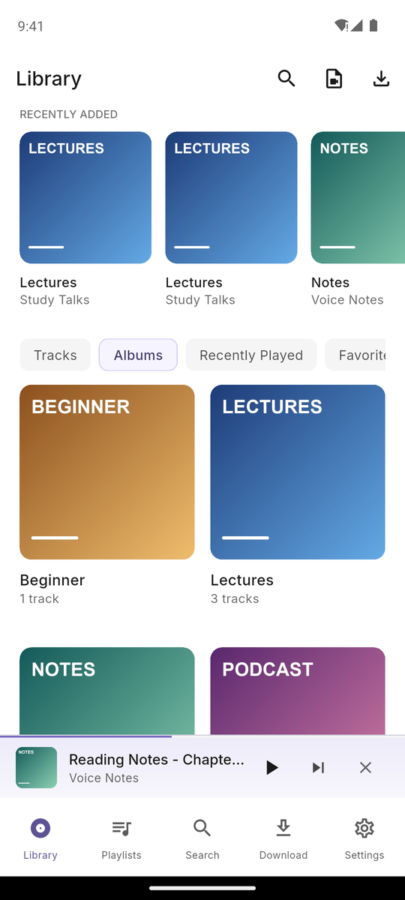<br/>
<b>Light theme</b><br/>
Pick Light, Dark, or follow your phone's setting.
</td>
<td width="33%" valign="top" align="center">
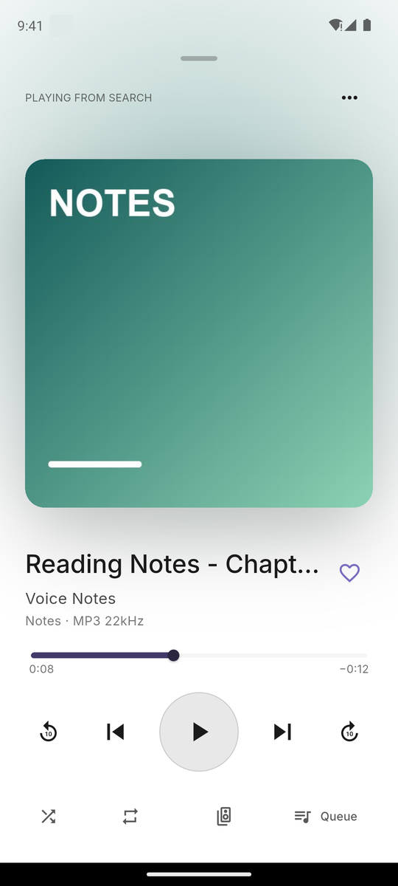<br/>
<b>Looks right in both</b><br/>
Every screen is designed for both themes, not just recoloured.
</td>
</tr>
</table>

### Controls everywhere you need them

Playback keeps going when the screen is off or you switch to another app, and you can control it without opening Listeny.

<table>
<tr>
<td width="55%" valign="top" align="center">
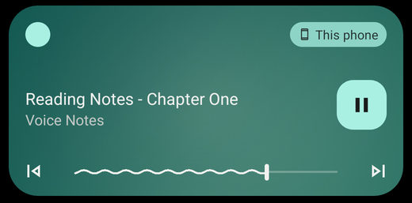<br/>
<b>Notification shade</b><br/>
Previous, play or pause, and next, with a seek bar.
</td>
<td width="45%" valign="top" align="center">
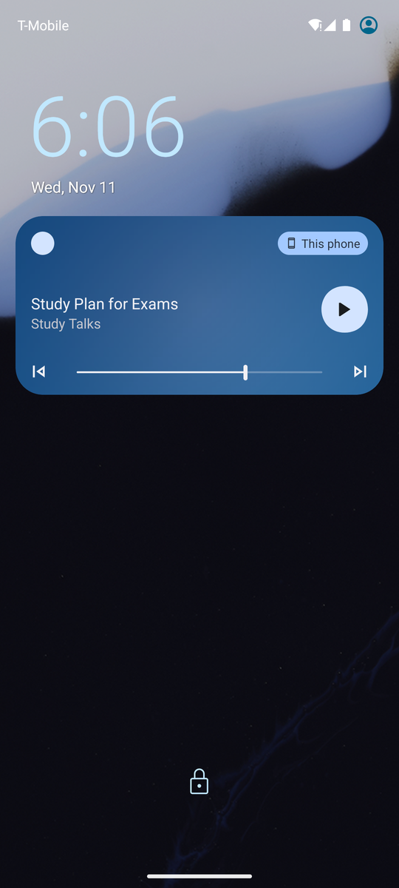<br/>
<b>Lock screen</b><br/>
The same controls without unlocking the phone. Bluetooth and headset buttons work too.
</td>
</tr>
</table>

---

## Getting audio into Listeny

You have four ways in, and none of them needs an account.

| Way in | What it does |
|---|---|
| **Import Audio** | Pick files from your phone. MP3, M4A, AAC, WAV, FLAC and AIFF are supported. |
| **Import video as MP3** | Choose a video you already have and keep just the audio, with its tags. |
| **Download** | Paste a direct link to an audio or video file and get an MP3. |
| **Sync Library** | Optional. Adds the MP3 files already on your phone, without copying them. |

Duplicates are detected, so adding the same file twice won't clutter your library.

## Privacy

- No account, no sign-up, no analytics.
- Your library never leaves the phone.
- The app only goes online when you ask it to download a link.
- You can use it without granting any storage permission. It asks for audio access only if you choose to sync files already on the phone.

## Languages

English, Arabic, Bengali, Spanish, French, Hindi, Portuguese, Russian, Urdu and Chinese. Right-to-left languages get a properly mirrored layout.

## Questions

**Does it need internet?**
Only for downloading from a link. Everything else works offline.

**Why is the file about 150 MB?**
It includes an audio converter, which is what lets it turn videos and downloads into MP3.

**Is there an iPhone version?**
Not yet. See the note under Download.

**Will it replace my existing files?**
No. Imported files are copied into the app and your originals are left alone. Trimming only replaces the original if you choose "Replace original".

## Build it yourself

This repository has the full source. You need Flutter (Dart 3.13.1 or newer; the project is built on Flutter 3.47) and the Android SDK.

```bash
git clone https://github.com/mukaddam-ali/Listeny-App.git
cd Listeny-App
flutter pub get
flutter run
```

To build a release APK, copy `android/key.properties.example` to `android/key.properties`, fill in your own signing key, then run `flutter build apk --release`.

If you change the database schema or the translation files, regenerate the code:

```bash
dart run build_runner build --delete-conflicting-outputs
flutter gen-l10n
```

Run the tests with `flutter analyze` and `flutter test`.

| Folder | What's in it |
|---|---|
| `lib/` | The Flutter app: playback, library, import logic, and one folder per screen |
| `android/`, `ios/` | Platform projects. The Android side handles MediaStore access and publishing files |
| `third_party/` | Patched copies of a few dependencies |
| `test/` | Unit and widget tests |
| `design/` | The original HTML design prototype the UI was ported from |
| `docs/` | Longer write-ups: [architecture](docs/ARCHITECTURE.md) and [storage](docs/STORAGE.md) |

---

<div align="center">

Built by **Ali Almoukaddam**

</div>
