<div align="center">

> **A note before you start**
>
> Listeny was built by a Muslim developer, for purposes other than songs. Songs and musical instruments (*al-ma'azif*) are haram in Islam, so this app was made for listening to the Qur'an, podcasts, poetry, lectures, and any other audio that isn't songs. Please respect that.
>
> **ملاحظة قبل أن تبدأ:** برمج هذا التطبيق مسلم، لأغراض غير الأغاني. فالأغاني والمعازف حرام في الإسلام، وإنما صُنع التطبيق للاستماع إلى القرآن والبودكاست والشعر والمحاضرات وكل ما سوى ذلك. نرجو من الجميع احترام ذلك.

<br/>

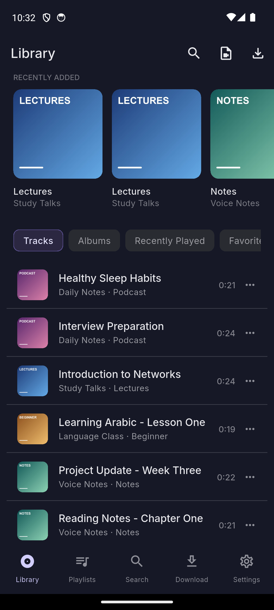

# Listeny Lite

**Your audio, on your phone, without the cloud.**

A private audio player for Android and iPhone. **No ads, no account, no tracking**, and it works without internet. Import files, turn videos into MP3, trim and merge recordings, and download from direct links.

<br/>

[**⬇ Download for Android**](https://github.com/mukaddam-ali/Listeny-App/releases/latest)

Version 1.6.1 &nbsp;·&nbsp; Android 7.0 or newer &nbsp;·&nbsp; about 150 MB &nbsp;·&nbsp; iPhone build also available (see Download)

</div>

---

## Why Listeny

Most players want you to sign in, sync to a server or stream everything. Listeny does the opposite. You bring the recordings you already have, it keeps them on your phone, and from then on everything works offline: browsing, searching, playlists, background playback and the lock-screen controls.

- **No ads.** None, and no trackers or analytics either.
- **Private by design.** Nothing is uploaded. The library is a database that lives on your phone.
- **Built for listening.** Skip back and forward 10 seconds, remember where you stopped, keep playing with the screen off.
- **Tidy.** Tracks, albums, playlists and favourites, with fast search.
- **Yours to edit.** Rename tracks, trim them, merge two into one, or pull the audio out of a video.

## Everything it can do

**Getting audio in**

- **Import audio files** from your phone: MP3, M4A, AAC, WAV, FLAC and AIFF.
- **Turn a video into audio.** Pick a video, name the track, and keep just the sound as an MP3.
- **Download from links.** Paste a direct link to an audio or video file and Listeny saves it as an MP3. You can run up to three downloads at once, cancel any of them, and see a history of what you downloaded.
- **Sync what's already on your phone.** Optional, and it never copies or deletes your files.
- **Skip duplicates.** Adding the same file twice won't clutter your library.
- **Files you can find.** Downloads, video conversions, merged and trimmed tracks are saved in `Music/Listeny`, so they show up in your file manager (Android 11 and newer).

**Listening**

- Keeps playing with the screen off, in the background, or with the phone locked.
- **Controls everywhere:** notification shade, lock screen, and Bluetooth or headset buttons.
- Seek bar, 10-second back and forward, shuffle and repeat.
- **Stop after this track:** one tap and playback ends when the current track finishes, instead of moving on or repeating. Handy for falling asleep to a lecture.
- **Queue:** play now, play next, add to queue, drag to reorder, clear what's left.
- Remembers your queue and position when you reopen the app. It never starts playing by itself.
- Optional setting to keep playing after you close the app.

**Organising**

- Tabs for Tracks, Albums, Recently Played and Favourites, plus a Recently Added row.
- Album and artist pages.
- **Playlists:** create, rename, reorder, and a cover made from the tracks inside.
- Favourites, play counts, and fast search across tracks, albums, artists and playlists.
- Long-press to select several tracks, then add them to a playlist or delete them together.
- Rename tracks and albums. Deleting asks whether to remove from the library only or delete the file too.

**Editing**

- **Merge two tracks:** long-press two tracks, tap the merge button, choose which goes first and name the result. It is saved as a new track and the originals are left untouched.
- **Trim:** drag the waveform handles or type exact start and end times, preview from any point, add a 1, 2 or 3 second fade, then save as a new track or replace the original.
- A trimmed copy keeps the original's name with a number, like "Lesson (2)", and the same cover.
- **Convert video to MP3:** pick any video on your phone, name it, and keep just the audio.

**Look and feel**

- Light, dark, or follow the phone.
- 10 languages, including proper right-to-left layouts.

**Privacy**

- No ads, no account, no analytics, no cloud. Everything stays on the phone.

## What it can and can't do

**It can**

- Import audio files, convert videos to MP3, and download from direct links and public Google Drive files.
- Play in the background, with notification, lock-screen and Bluetooth controls.
- Organise with albums, playlists, favourites and search, and edit with rename, trim and merge.
- Work completely offline, and keep every file on your phone.

**It can't (on purpose)**

- Download from streaming or social-media sites. Only direct links to a file work. Those services' terms don't allow it, so Listeny Lite doesn't try.
- Sync to a cloud account, or stream anything.
- Share your library with other people or devices.
- Apply sound effects such as an equaliser, or change the speed or pitch of a recording.

## Download and install

**Android**

1. On your phone, open the [latest release](https://github.com/mukaddam-ali/Listeny-App/releases/latest) and download **Listeny-Lite-1.6.1.apk**.
2. Open the file. If Android asks, allow your browser or file manager to install apps from this source.
3. Tap **Install**, then open Listeny.

One APK works on every Android phone (Samsung, Motorola, Xiaomi, Vivo, Oppo, Pixel and the rest).

Because the app isn't on the Play Store, Google Play Protect may show a warning the first time. That's normal for any app installed outside the store.

SHA-256 of the APK, if you'd like to check your download:

```
b6a1434f99d9d6193d45f08770f1d06020cb8d32c27e9e087b4a2f856656c5fb
```

**iPhone**

The iPhone build is an **unsigned IPA** (`Listeny-Lite-unsigned.ipa`, about 27 MB), attached to the same release. Apple doesn't allow installing apps outside the App Store without signing, so you sign it yourself with a free tool such as [Sideloadly](https://sideloadly.io) or [AltStore](https://altstore.io):

1. Download the IPA from the [latest release](https://github.com/mukaddam-ali/Listeny-App/releases/latest) to a computer.
2. Open it in Sideloadly (or AltStore) and sign in with your own Apple ID.
3. Install it on your iPhone, then trust the developer under Settings, General, VPN & Device Management.

SHA-256 of the IPA:

```
1289f4fe9ff30bf73d5a8d8790abf9d53bc93af11087fce0c6e4acb8aa79a6a4
```

With a free Apple ID the app expires after 7 days and has to be re-signed. The iPhone version is built automatically on Apple hardware, but it hasn't been tested on a real iPhone yet, so expect rough edges. Android is the version I use every day.

---

## A tour of the app

### Adding audio

<table>
<tr>
<td width="33%" valign="top" align="center">
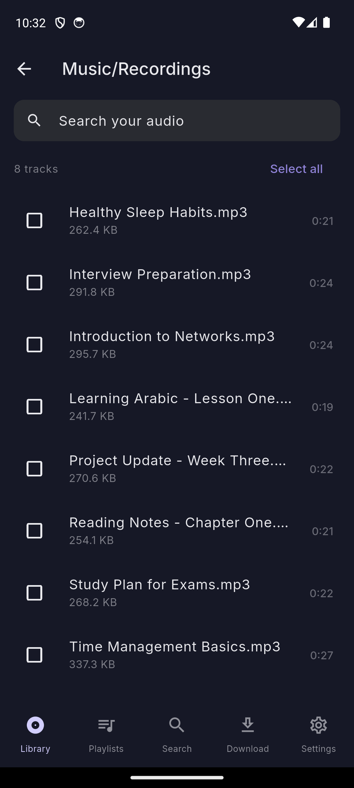<br/>
<b>Choose audio</b><br/>
Browse the audio already on your phone by folder, search it, and tick what you want.
</td>
<td width="33%" valign="top" align="center">
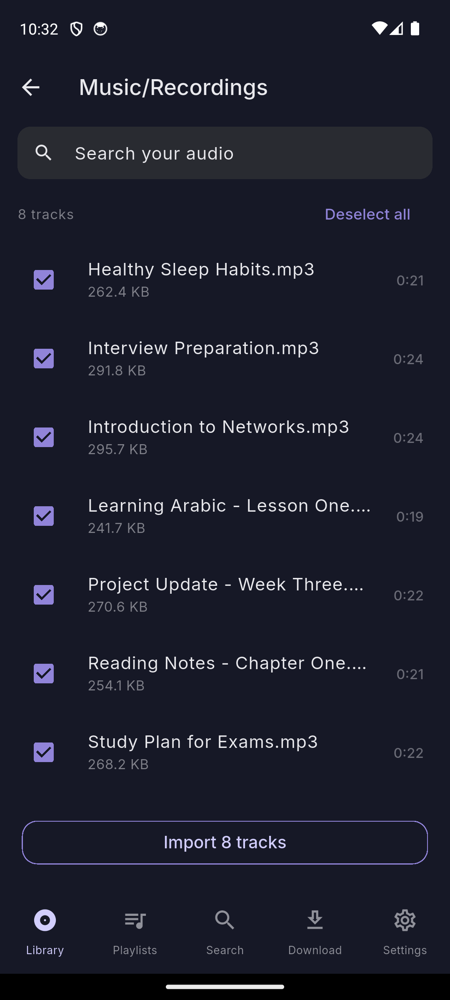<br/>
<b>Select and import</b><br/>
Select everything in a folder with one tap, or pick tracks one by one.
</td>
<td width="33%" valign="top" align="center">
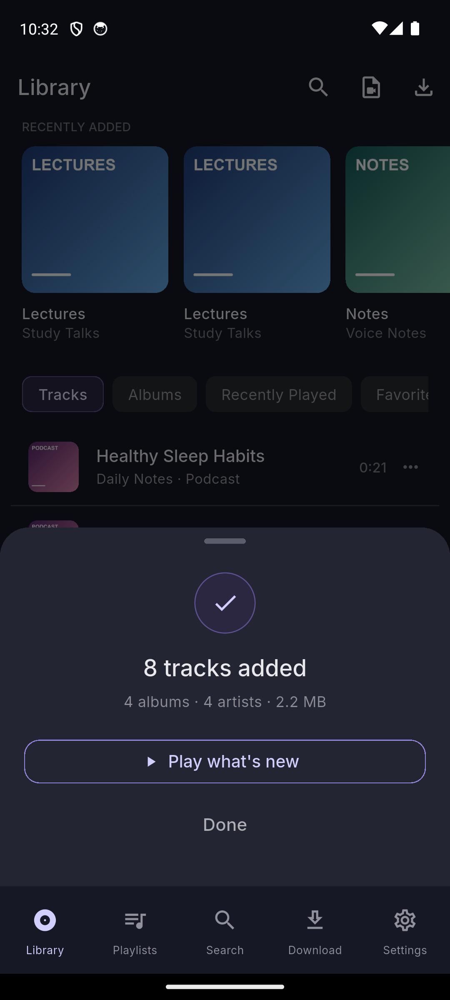<br/>
<b>Done</b><br/>
A summary of what was added, with a shortcut to play it straight away.
</td>
</tr>
</table>

### Your library

<table>
<tr>
<td width="33%" valign="top" align="center">
<br/>
<b>Library</b><br/>
Everything you've added, with the newest at the top. Switch between Tracks, Albums, Recently Played and Favourites.
</td>
<td width="33%" valign="top" align="center">
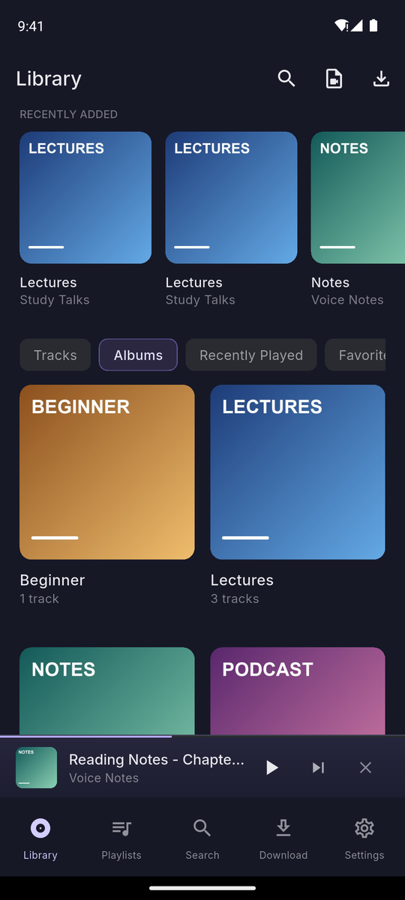<br/>
<b>Albums</b><br/>
Your tracks grouped by album, using the cover art stored in each file.
</td>
<td width="33%" valign="top" align="center">
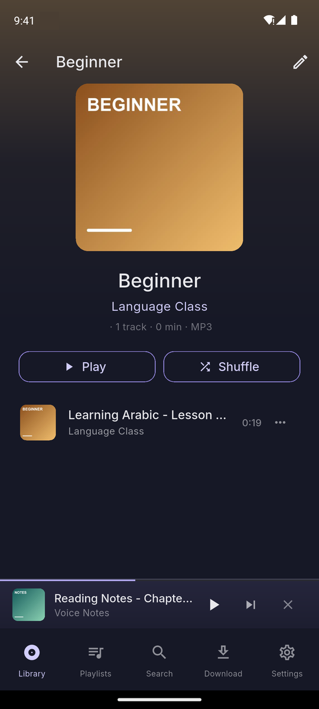<br/>
<b>Album page</b><br/>
Play or shuffle a whole album, or edit its details with the pencil.
</td>
</tr>
</table>

### Listening

<table>
<tr>
<td width="33%" valign="top" align="center">
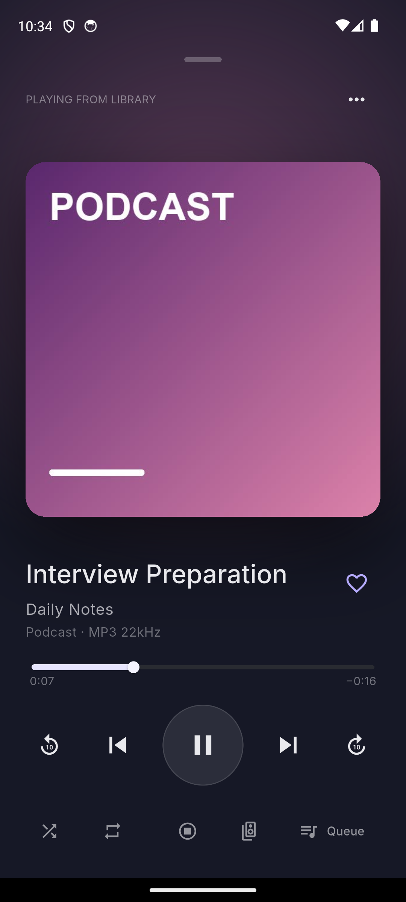<br/>
<b>Now playing</b><br/>
Big cover, a seek bar, previous and next, plus 10-second back and forward buttons. Shuffle, repeat and the queue are one tap away.
</td>
<td width="33%" valign="top" align="center">
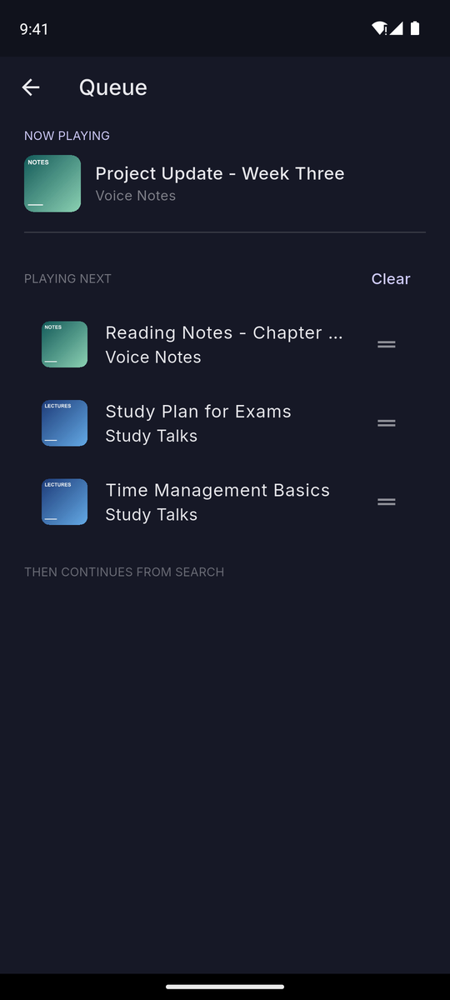<br/>
<b>Queue</b><br/>
See what's coming next. Drag to reorder, or clear everything that's still waiting.
</td>
<td width="33%" valign="top" align="center">
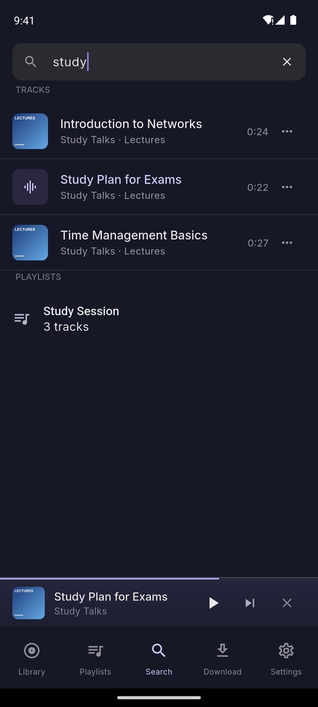<br/>
<b>Search</b><br/>
Type a few letters and get matching tracks, albums, artists and playlists straight away.
</td>
</tr>
</table>

### Playlists and organising

<table>
<tr>
<td width="33%" valign="top" align="center">
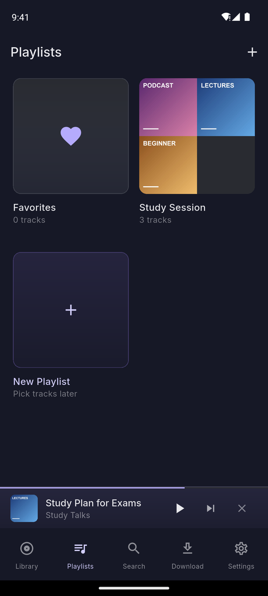<br/>
<b>Playlists</b><br/>
Create playlists and keep a Favourites list. Each playlist gets a cover made from its tracks.
</td>
<td width="33%" valign="top" align="center">
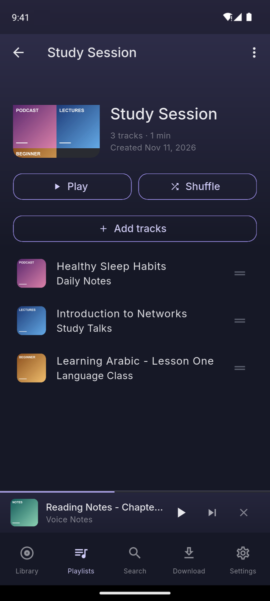<br/>
<b>Inside a playlist</b><br/>
Play, shuffle, add tracks, and drag the handles to put them in the order you like.
</td>
<td width="33%" valign="top" align="center">
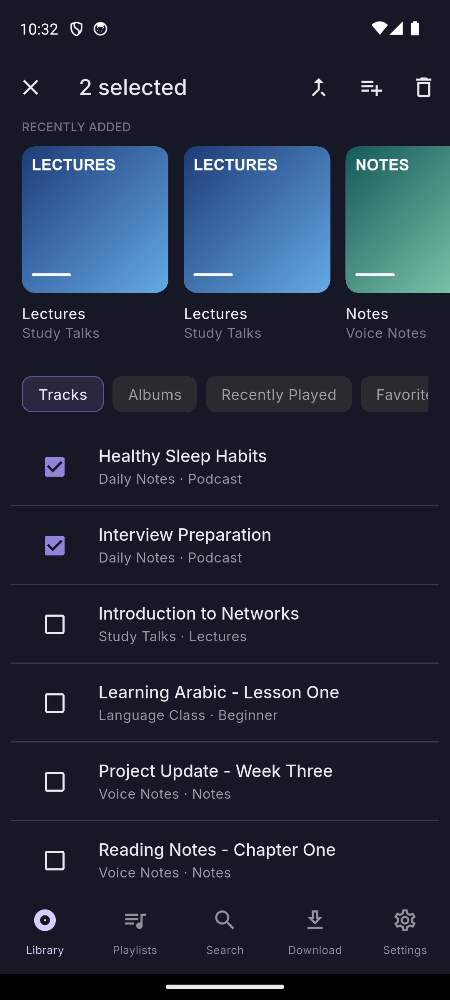<br/>
<b>Select several</b><br/>
Long-press a track to select more, then add them all to a playlist or delete them together. With exactly two selected, a merge button appears.
</td>
</tr>
</table>

### Tools

<table>
<tr>
<td width="33%" valign="top" align="center">
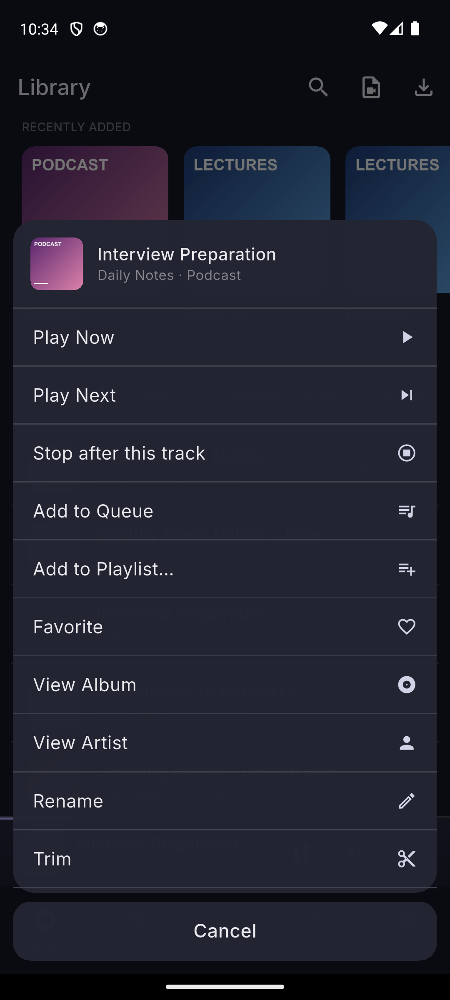<br/>
<b>Track menu</b><br/>
Tap the three dots on any track: play now, play next, add to queue or a playlist, favourite, rename, trim or remove. For the track that's playing there's also "Stop after this track".
</td>
<td width="33%" valign="top" align="center">
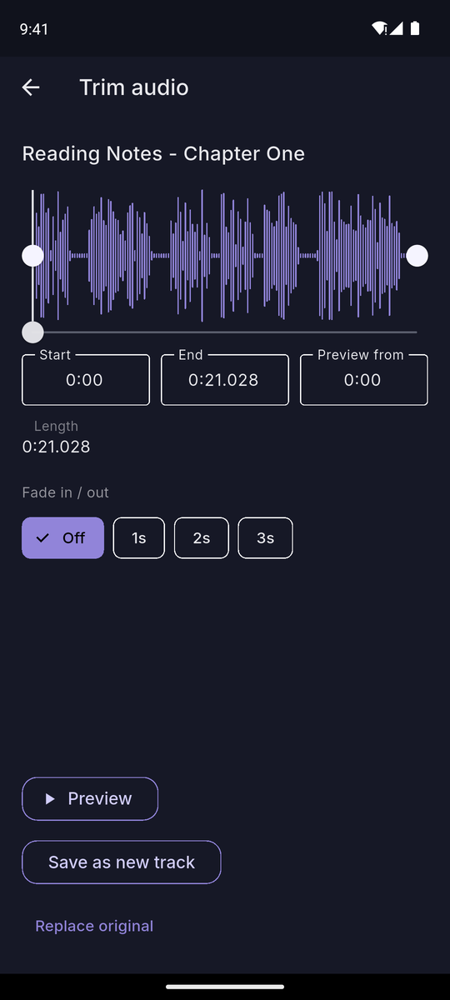<br/>
<b>Trim</b><br/>
Cut a recording down to the part you want. Drag the handles or type exact start and end times, preview it, add a fade, then save a new track or replace the original.
</td>
<td width="33%" valign="top" align="center">
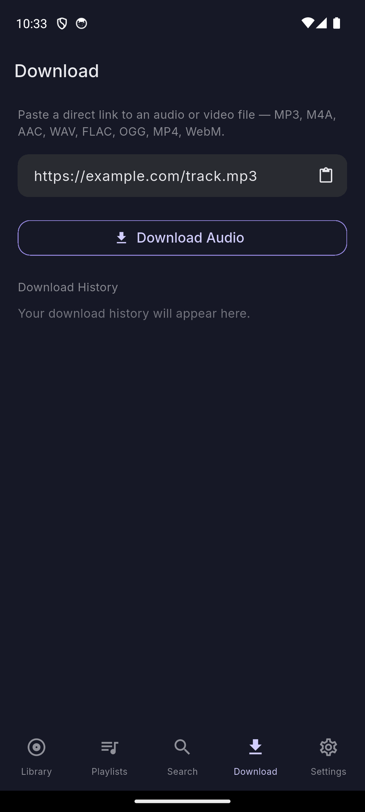<br/>
<b>Download from a link</b><br/>
Paste a direct link to an audio or video file and Listeny saves it as an MP3.
</td>
</tr>
</table>

### Merge and stop

<table>
<tr>
<td width="33%" valign="top" align="center">
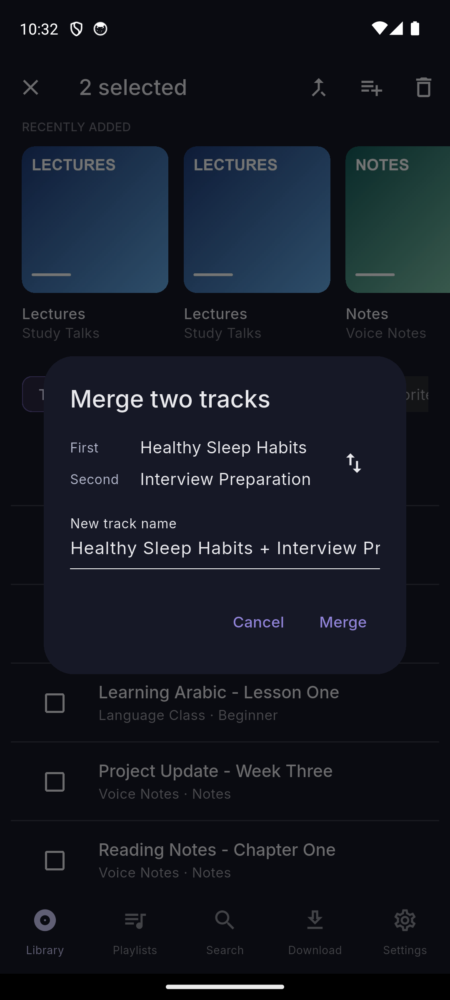<br/>
<b>Merge two tracks</b><br/>
Pick the order (swap with the arrows), name the new track, and tap Merge.
</td>
<td width="33%" valign="top" align="center">
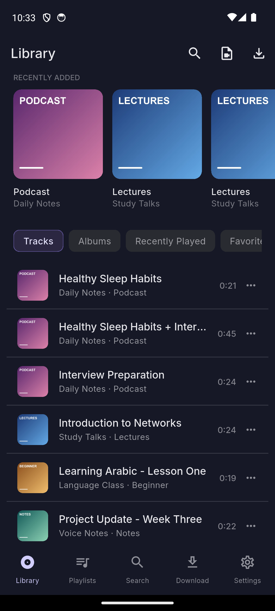<br/>
<b>A new track</b><br/>
The merged track appears in your library with the combined length. The two originals stay where they were.
</td>
<td width="33%" valign="top" align="center">
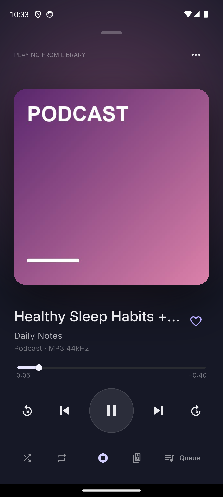<br/>
<b>Stop after this track</b><br/>
The highlighted button on the Now Playing screen. When the track ends, playback stops on that track, ready to replay.
</td>
</tr>
</table>

### Settings and themes

<table>
<tr>
<td width="33%" valign="top" align="center">
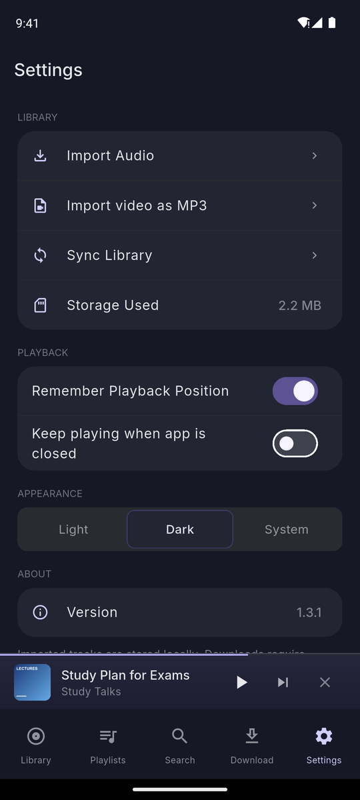<br/>
<b>Settings</b><br/>
Import audio, extract audio from a video, sync what's already on your phone, and see how much space Listeny uses. Choose whether it remembers your position and whether it keeps playing after you close the app.
</td>
<td width="33%" valign="top" align="center">
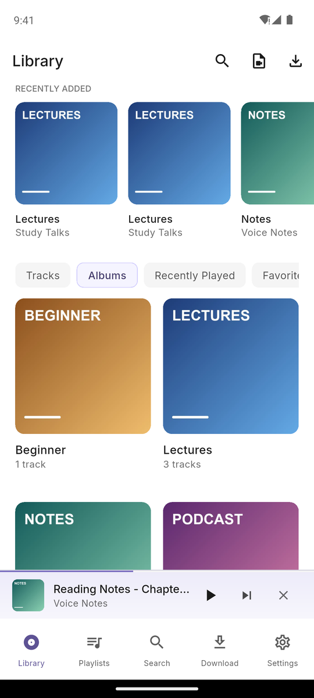<br/>
<b>Light theme</b><br/>
Pick Light, Dark, or follow your phone's setting.
</td>
<td width="33%" valign="top" align="center">
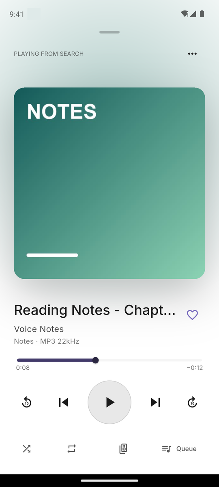<br/>
<b>Looks right in both</b><br/>
Every screen is designed for both themes, not just recoloured.
</td>
</tr>
</table>

### Controls everywhere you need them

Playback keeps going when the screen is off or you switch to another app, and you can control it without opening Listeny.

<table>
<tr>
<td width="55%" valign="top" align="center">
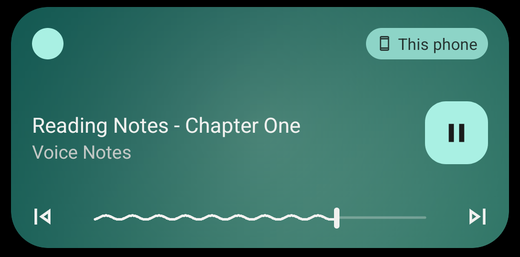<br/>
<b>Notification shade</b><br/>
Previous, play or pause, and next, with a seek bar.
</td>
<td width="45%" valign="top" align="center">
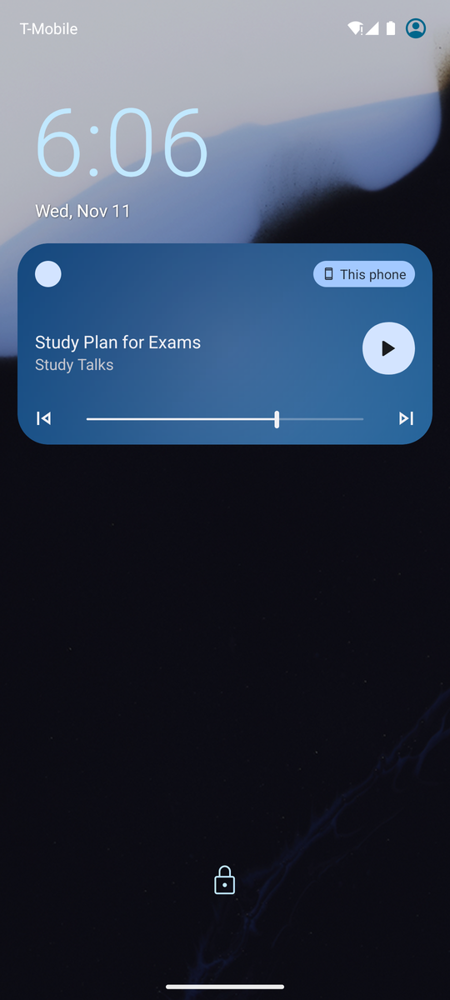<br/>
<b>Lock screen</b><br/>
The same controls without unlocking the phone. Bluetooth and headset buttons work too.
</td>
</tr>
</table>

---

## Getting audio into Listeny

You have four ways in, and none of them needs an account.

| Way in | What it does |
|---|---|
| **Import Audio** | Pick files from your phone. MP3, M4A, AAC, WAV, FLAC and AIFF are supported. |
| **Import video as MP3** | Choose a video you already have, name it, and keep just the audio. |
| **Download** | Paste a direct link to an audio or video file and get an MP3. |
| **Sync Library** | Optional. Adds the MP3 files already on your phone, without copying them. |

Duplicates are detected, so adding the same file twice won't clutter your library.

## Privacy

- No account, no sign-up, no analytics.
- Your library never leaves the phone.
- The app only goes online when you ask it to download a link.
- You can use it without granting any storage permission. It asks for audio access only if you choose to sync files already on the phone.

## Languages

English, Arabic, Bengali, Spanish, French, Hindi, Portuguese, Russian, Urdu and Chinese. Right-to-left languages get a properly mirrored layout.

## Questions

**Does it need internet?**
Only for downloading from a link. Everything else works offline.

**Why is the file about 150 MB?**
It includes an audio converter, which is what lets it turn videos and downloads into MP3.

**Is there an iPhone version?**
Yes, as an unsigned IPA you sign yourself. See Download and install.

**Can I merge more than two tracks?**
Not at once. Merge two, then merge the result with another.

**Will it replace my existing files?**
No. Imported files are copied into the app and your originals are left alone. Trimming only replaces the original if you choose "Replace original".

## Build it yourself

This repository has the full source. You need Flutter (Dart 3.13.1 or newer; the project is built on Flutter 3.47) and the Android SDK.

```bash
git clone https://github.com/mukaddam-ali/Listeny-App.git
cd Listeny-App
flutter pub get
flutter run
```

To build a release APK, copy `android/key.properties.example` to `android/key.properties`, fill in your own signing key, then run `flutter build apk --release`.

If you change the database schema or the translation files, regenerate the code:

```bash
dart run build_runner build --delete-conflicting-outputs
flutter gen-l10n
```

Run the tests with `flutter analyze` and `flutter test`.

| Folder | What's in it |
|---|---|
| `lib/` | The Flutter app: playback, library, import logic, and one folder per screen |
| `android/`, `ios/` | Platform projects. The Android side handles MediaStore access and publishing files |
| `third_party/` | Patched copies of a few dependencies |
| `test/` | Unit and widget tests |
| `design/` | The original HTML design prototype the UI was ported from |
| `docs/` | Longer write-ups: [architecture](docs/ARCHITECTURE.md) and [storage](docs/STORAGE.md) |

---

<div align="center">

Built by **Ali Almoukaddam**

</div>
